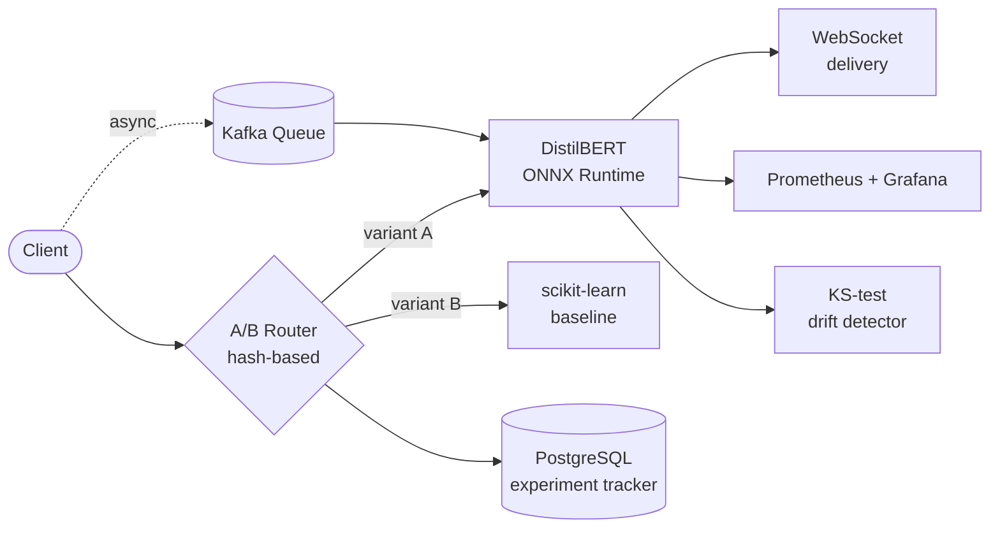

 

-University%20of%20Georgia-B22222?style=flat-square)

---

### 🕷️ Radioactive Origin

I was bitten by backend engineering somewhere around a computer science degree (AI emphasis) at the University of Georgia, and I never quite recovered. Most of my work lives where fast, reliable systems meet an ML-aware layer swinging on top.

The unglamorous parts are half the appeal: chasing a flaky service through a stack trace at midnight, writing a Terraform module boring enough that nobody has to think about it again, catching a timezone bug before it catches me. If a system is observable, reproducible, and operable by someone who is not me, that is the kind of web I want to build.

---

### 🦸 Currently Swinging

| | |
|---|---|
| 🎓 **IT Professional Assistant** @ UGA Franklin College OIT | Keeping a university's worth of systems running |
| 🔬 **Building** | **RaftKV**, a Raft-based distributed key-value store, from scratch in Go |
| 📜 **Studying** | AWS Solutions Architect Professional |

---

### 🧪 The Serum: InferGrid

Every hero has an origin experiment. Mine is **InferGrid**, a production-grade distributed ML inference platform on GCP, and the project where backend engineering and applied AI fuse into one working system.

- ⚡ Sub-100ms p95 latency at 500+ requests per minute
- ☸️ Kubernetes autoscaling for inference workloads
- 🔀 Deterministic A/B model routing between DistilBERT and a scikit-learn baseline
- 📨 Kafka-backed async inference queue with WebSocket result delivery
- 📉 Drift detection on live traffic (KS-test) and Prometheus/Grafana observability
- 🖥️ React dashboard on Vercel for watching routing, latency, and drift

---

### 🌃 Patrols Across the City

<table>
<tr>
<td width="50%" valign="top">

#### 🚨 Sentra
**AI incident-triage copilot.** A tool-calling LLM agent investigates simulated production incidents using read-only diagnostics (logs, metrics, deploys, runbooks) and returns root-cause hypotheses with cited evidence, streamed to a Next.js evidence viewer.

- Human approval for restarts/rollbacks enforced in **orchestration code, not the prompt**, with an append-only audit trail
- **100% root-cause accuracy and valid citations** across 12 live-LLM runs on 6 seeded failure scenarios; 0 approval-gate bypasses
- 135 automated tests, CI across three services

`Next.js` `FastAPI` `pgvector` `Gemini` `Docker`

</td>
<td width="50%" valign="top">

#### 🧩 RaftKV *(in progress)*
**Distributed key-value store implementing Raft from scratch** in Go/gRPC: leader election, log replication, snapshotting, and a write-ahead log with torn-tail repair.

- Fault-injecting filesystem and crash-recovery tests
- Next up: a chaos-testing harness with a **linearizability verifier**
- Suite green and clean under Go's `-race` detector

`Go` `gRPC` `Raft` `WAL`

</td>
</tr>
<tr>
<td width="50%" valign="top">

#### 🤖 Job Agent *(in design)*
**Local-first, CLI-driven multi-agent assistant** that detects job postings, researches sponsorship evidence, and tailors resumes truthfully. Human stays in the loop: no auto-submit, no pay-per-token APIs.

`Multi-agent` `CLI` `Codex` `Claude Code`

</td>
<td width="50%" valign="top">

#### 🌊 Clickstream Lake *(in progress)*
**Serverless AWS data lake** for simulated e-commerce events: S3 tiered storage, Glue ETL to partitioned Parquet, Athena analytics, QuickSight dashboards, with cost guardrails and IaC via CDK.

`S3` `Glue` `Athena` `QuickSight` `CDK`

</td>
</tr>
<tr>
<td width="50%" valign="top">

#### 🔭 Nexus & VectorForge
**Distributed observability.** Nexus traces requests and monitors service health across a cluster, the kind of tool you build so the next 2am page is shorter. VectorForge extends the observability thread.

`Tracing` `Metrics` `Distributed Systems`

</td>
<td width="50%" valign="top">

#### 🏆 Procuroid
**Multi-agent procurement system.** Honorable Mention at **AI ATL 2025**, Google Cloud track.

`Multi-agent` `Google Cloud`

</td>
</tr>
<tr>
<td width="50%" valign="top">

#### 📬 AtlasFlow
**Event-driven backend** on DynamoDB and SQS, built for decoupled, asynchronous processing instead of one long synchronous chain.

`DynamoDB` `SQS` `AWS`

</td>
<td width="50%" valign="top">

#### 📸 PixelVault
**Zero-cost photo archival pipeline.** iPhone photos route through a Vercel relay to an old Pixel XL for free, unlimited Google Photos backup. A fun systems-automation heist.

`Next.js` `Kotlin` `iOS Shortcuts`

</td>
</tr>
<tr>
<td width="50%" valign="top">

#### 🕸️ FraudSense
**Fraud detection with graph-structured models**, built to catch the patterns flat tabular data quietly misses.

`Graph ML` `Python`

</td>
<td width="50%" valign="top">

#### 🧪 Mini ML Platform
A smaller-scale run at the ideas behind InferGrid, the proving ground before the real thing got built.

`MLOps` `Python`

</td>
</tr>
</table>

---

### 🧰 Utility Belt

**Languages**

**Backend, Cloud & Infra**

**Data, Messaging & Observability**

---

### 🎖️ Certifications

---

### 🕸️ Spider Sense (Live Activity)

  
  

---

### 📖 The Code I Swing By

> With great scale comes great responsibility, for uptime, for logs, and for whoever is on call when things break at 2am.
>
> Build systems that are observable.
>
> Build systems that fail gracefully instead of embarrassingly.
>
> Build systems someone else can swing through without needing a map.

---

<b>🎭 Unmasked</b>

 

- I have strong opinions about logging and monitoring, and I will share them whether you ask or not.
- Most of my side projects start small and quietly turn into full infrastructure projects.
- Debugging almost always starts in the code and ends in the logs.
- I once spent an embarrassing number of hours tracking down a single timezone bug.
- The Kafka cluster is probably fine.

---

